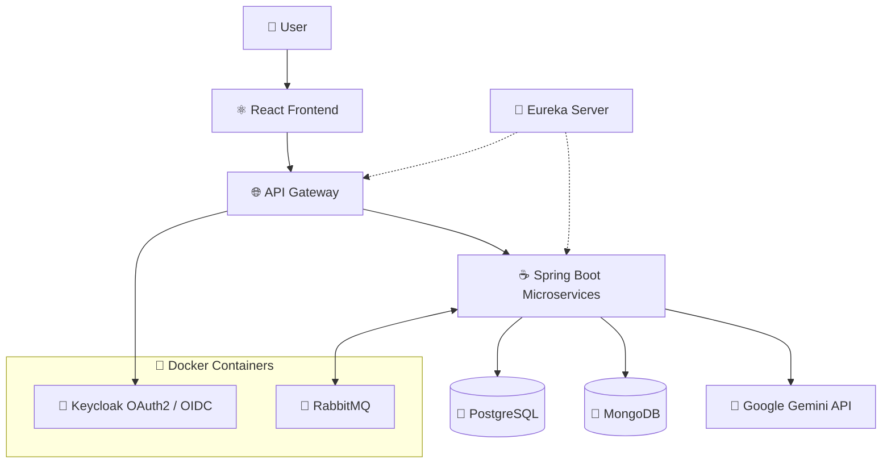
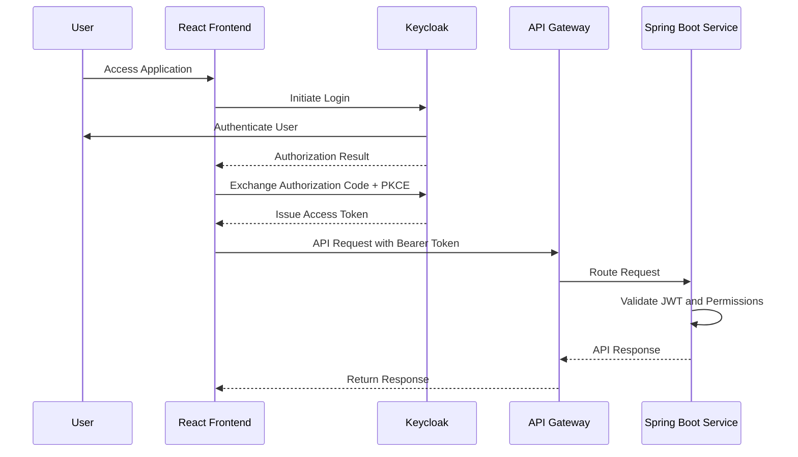
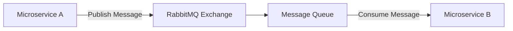

# 🏋️ FitVerse – AI-Powered Fitness Platform

FitVerse is a full-stack, AI-powered fitness application built using a **microservices architecture** to provide a modern, scalable, and personalized fitness experience.

The application combines **React.js, Spring Boot, PostgreSQL, MongoDB, RabbitMQ, Keycloak, Docker, and Google Gemini AI** to deliver intelligent fitness services with secure authentication, distributed data management, and asynchronous communication.

FitVerse is designed to demonstrate real-world backend engineering concepts, including microservices, service discovery, API Gateway routing, event-driven architecture, OAuth2 authentication, containerization, and generative AI integration.

> 🚧 **Project Status:** Under Active Development

---

## 🌟 Key Highlights

- 🏗️ Microservices-based backend architecture
- ⚛️ Modern frontend using React.js
- ☕ RESTful APIs powered by Java and Spring Boot
- 🗄️ Hybrid database architecture using PostgreSQL and MongoDB
- 🤖 Google Gemini AI integration
- 🔐 OAuth2 and OpenID Connect authentication using Keycloak
- 📨 Asynchronous inter-service communication using RabbitMQ
- 🐳 Docker containerization for RabbitMQ and Keycloak
- 🔎 Service discovery using Netflix Eureka Server
- 🌐 Centralized API routing through an API Gateway
- 🛡️ Spring Security for API protection
- ✅ Request validation using Spring Boot Validation
- 📦 Modular architecture for maintainability and scalability

---

## 🛠️ Technology Stack

### 🎨 Frontend

| Technology | Purpose |
|---|---|
| React.js | Component-based frontend development |
| JavaScript | Frontend application logic |
| HTML5 | Application structure |
| CSS3 | Styling and responsive layouts |
| REST APIs | Communication with backend services |

### ⚙️ Backend

| Technology | Purpose |
|---|---|
| Java | Backend programming language |
| Spring Boot | Microservices development |
| Spring Web | RESTful API development |
| Spring Data JPA | Relational database persistence |
| Spring Data MongoDB | NoSQL database operations |
| Spring Security | Authentication and authorization |
| Spring Validation | Request and data validation |
| Spring Cloud Netflix Eureka | Service registration and discovery |
| Spring Cloud Gateway | Centralized API routing |

### 🗄️ Database

| Technology | Purpose |
|---|---|
| PostgreSQL | Relational data storage |
| MongoDB | Document-oriented data storage |

FitVerse follows a **polyglot persistence approach**, selecting the appropriate database technology based on individual microservice requirements.

### 🔐 Authentication & Security

| Technology | Purpose |
|---|---|
| Keycloak | Identity and access management |
| OAuth 2.0 | Authorization framework |
| OpenID Connect | Authentication protocol |
| Spring Security | Securing backend APIs |
| JWT | Token-based authentication |

### 📨 Asynchronous Communication

| Technology | Purpose |
|---|---|
| RabbitMQ | Message broker for asynchronous communication |
| AMQP | Messaging protocol |
| Spring AMQP | RabbitMQ integration with Spring Boot |

### 🐳 Containerization

| Technology | Purpose |
|---|---|
| Docker | Containerization |
| Docker Containers | Running RabbitMQ and Keycloak |
| Docker Images | Packaging infrastructure services |

### 🤖 Artificial Intelligence

| Technology | Purpose |
|---|---|
| Google Gemini AI | Generative AI integration |
| Gemini API | AI-powered request processing |

---

## 🏗️ System Architecture

FitVerse follows a distributed microservices architecture where the React frontend communicates with backend services through an API Gateway.

Eureka Server manages service discovery, RabbitMQ enables asynchronous communication, and Keycloak handles centralized authentication.



### Architecture Components

1. **React Frontend:** Provides the user interface and communicates with backend APIs.
2. **API Gateway:** Acts as the centralized entry point for client requests and routes them to appropriate services.
3. **Eureka Server:** Maintains a registry of available microservices for dynamic service discovery.
4. **Spring Boot Microservices:** Handle independent business functionalities.
5. **PostgreSQL:** Stores structured relational data.
6. **MongoDB:** Stores flexible document-oriented data.
7. **RabbitMQ:** Enables asynchronous communication between microservices.
8. **Keycloak:** Provides centralized authentication and identity management.
9. **Google Gemini AI:** Provides generative AI capabilities.
10. **Docker:** Runs RabbitMQ and Keycloak in isolated containers.

---

## 🔐 Authentication & Authorization

FitVerse integrates **Keycloak** as its OAuth2 and OpenID Connect identity provider.

Keycloak runs inside a Docker container, providing centralized identity management independently of the Spring Boot application.

Spring Security protects backend resources by validating JWT access tokens issued by Keycloak.

### Authentication Flow



### Security Features

- Centralized user authentication
- OAuth2 authorization
- OpenID Connect integration
- Authorization Code Flow with PKCE
- JWT-based API security
- Protected REST endpoints
- Role-based access control
- Spring Security integration

---

## 📨 Asynchronous Communication with RabbitMQ

FitVerse uses **RabbitMQ** as its message broker to enable asynchronous communication between microservices.

RabbitMQ runs inside a Docker container and allows services to exchange messages without requiring direct synchronous communication for every operation.

### RabbitMQ Communication Flow



### Key Concepts

- **Producer:** Publishes messages to RabbitMQ.
- **Exchange:** Receives messages and routes them according to binding rules.
- **Queue:** Stores messages until they are consumed.
- **Consumer:** Processes messages asynchronously.
- **Binding:** Connects exchanges with queues using routing rules.

### Benefits

- Loose coupling between microservices
- Asynchronous message processing
- Improved service independence
- Reliable message delivery when appropriately configured
- Better handling of background operations
- Scalable event-driven workflows

---

## 🐳 Docker Integration

FitVerse uses Docker to containerize infrastructure components, specifically:

- RabbitMQ
- Keycloak

Running these services inside Docker containers simplifies local development, environment setup, and dependency management.

### RabbitMQ Container

RabbitMQ provides asynchronous messaging capabilities to the microservices.

### Keycloak Container

Keycloak provides centralized authentication and authorization using OAuth2 and OpenID Connect.

### Example Docker Commands

**Start RabbitMQ:**

```bash
docker run -d \
  --name fitverse-rabbitmq \
  -p 5672:5672 \
  -p 15672:15672 \
  rabbitmq:management
```

**Start Keycloak:**

```bash
docker run -d \
  --name fitverse-keycloak \
  -p 8080:8080 \
  quay.io/keycloak/keycloak:latest \
  start-dev
```

> These are development examples. Configure persistent volumes, credentials, secrets, and production settings before deployment. Use a pinned Keycloak image version rather than `latest` for reproducible environments.

---

## 🔎 Service Discovery with Eureka

FitVerse uses **Netflix Eureka Server** for microservice registration and discovery.

### How It Works

1. Eureka Server starts and maintains a service registry.
2. Spring Boot microservices register themselves with Eureka.
3. Registered services periodically renew their leases.
4. The API Gateway and other services discover registered instances.
5. Dynamic discovery supports flexible routing and inter-service communication.

### Benefits

- Dynamic service discovery
- Reduced dependency on hardcoded service addresses
- Support for multiple service instances
- Improved flexibility in distributed deployments

> Eureka is a service discovery server, not an API Gateway. Spring Cloud Gateway is used separately for centralized request routing.

---

## 🗄️ Database Architecture

FitVerse uses two database technologies to address different persistence requirements.

### PostgreSQL

PostgreSQL provides relational data storage with support for:

- Structured entities
- Relationships between entities
- Transaction management
- Data integrity
- SQL-based querying

Spring Data JPA provides object-relational mapping and database access.

### MongoDB

MongoDB provides document-oriented storage with support for:

- Flexible document structures
- JSON-like data representation
- Evolving data models
- Document-based queries

Spring Data MongoDB simplifies repository operations and document persistence.

### Persistence Strategy

Each microservice can use the database technology that best suits its requirements, keeping service-specific data models independent.

---

## 🤖 Google Gemini AI Integration

FitVerse integrates **Google Gemini AI** to support intelligent fitness-related functionality.

Potential AI-powered capabilities include:

- Personalized workout recommendations
- AI-generated fitness guidance
- Customized training suggestions
- Fitness-related question answering
- Personalized wellness recommendations

The Gemini API is accessed through backend services, keeping AI functionality separated from frontend implementation.

---

## 📁 Project Structure

The following is a suggested organization for the microservices-based repository. Actual directories may vary as development progresses.

```text
FitVerse/
│
├── frontend/
│   └── React Application
│
├── backend/
│   ├── api-gateway/
│   ├── eureka-server/
│   └── microservices/
│       └── Spring Boot Services
│
├── docker/
│   └── Infrastructure configurations
│
├── README.md
└── .gitignore
```

---

## ⚙️ Installation & Setup

### Prerequisites

- Java JDK compatible with your Spring Boot version
- Node.js and npm
- Maven
- PostgreSQL
- MongoDB
- Docker and Docker Compose (optional)
- Google Gemini API key
- Git

### 1. Clone the Repository

```bash
git clone https://github.com/Rashmi-2005-Ranjan/FitVerse.git
cd FitVerse
```

### 2. Start RabbitMQ and Keycloak

Start the Docker containers using the commands provided in the Docker Integration section.

Verify that both containers are running:

```bash
docker ps
```

### 3. Configure Backend Services

Configure each Spring Boot microservice with the appropriate environment variables.

**PostgreSQL:**

```properties
spring.datasource.url=${POSTGRES_URL}
spring.datasource.username=${POSTGRES_USERNAME}
spring.datasource.password=${POSTGRES_PASSWORD}
```

**MongoDB:**

```properties
spring.data.mongodb.uri=${MONGODB_URI}
```

**Eureka:**

```properties
eureka.client.service-url.defaultZone=${EUREKA_SERVER_URL}
```

**RabbitMQ:**

```properties
spring.rabbitmq.host=${RABBITMQ_HOST}
spring.rabbitmq.port=${RABBITMQ_PORT}
spring.rabbitmq.username=${RABBITMQ_USERNAME}
spring.rabbitmq.password=${RABBITMQ_PASSWORD}
```

**Keycloak / OAuth2 Resource Server:**

```properties
spring.security.oauth2.resourceserver.jwt.issuer-uri=${KEYCLOAK_ISSUER_URI}
```

**Gemini API:**

```properties
GEMINI_API_KEY=${GEMINI_API_KEY}
```

Adjust the configuration according to each microservice's actual requirements.

### 4. Start Eureka Server

Navigate to the Eureka Server module:

```bash
mvn spring-boot:run
```

### 5. Start Backend Microservices

Start each Spring Boot microservice independently:

```bash
mvn spring-boot:run
```

### 6. Start API Gateway

Start the configured API Gateway after the discovery infrastructure is available.

### 7. Start React Frontend

Navigate to the frontend directory:

```bash
cd frontend
npm install
npm run dev
```

Open the local development URL displayed by Vite.

---

## 📈 Future Roadmap

- [ ] Complete microservices integration
- [ ] Personalized fitness dashboard
- [ ] Workout planning and tracking
- [ ] AI-powered workout recommendations
- [ ] Fitness progress analytics
- [ ] Nutrition and wellness recommendations
- [ ] Event-driven notification workflows
- [ ] Docker Compose infrastructure setup
- [ ] Automated CI/CD pipeline
- [ ] Distributed monitoring and observability
- [ ] Production deployment

---

## 🎯 Project Objectives

FitVerse is being developed to strengthen practical experience in:

- Full-stack application development
- Java and Spring Boot backend engineering
- Microservices architecture
- Distributed systems
- Event-driven communication
- OAuth2 and OpenID Connect security
- Docker containerization
- Relational and NoSQL database integration
- Generative AI integration
- Scalable application design

---

## 👨‍💻 Developer

**Rashmi Ranjan Behera**

Full-Stack Developer | Java | Spring Boot | React.js | Microservices

**GitHub:** [Rashmi-2005-Ranjan](https://github.com/Rashmi-2005-Ranjan)

---

## ⭐ Support

If you find FitVerse interesting, consider giving the repository a ⭐ on GitHub.

Contributions, feedback, and suggestions are welcome as the project evolves.

---

**Built with Java, Spring Boot, React, Microservices, and AI.**

### Happy Coding! 🚀
