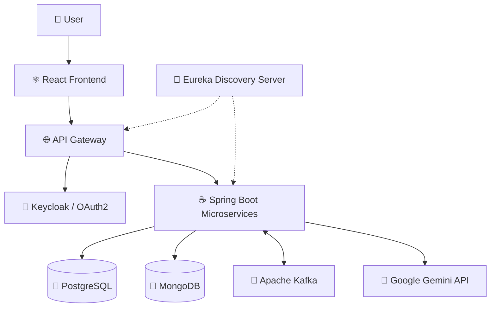
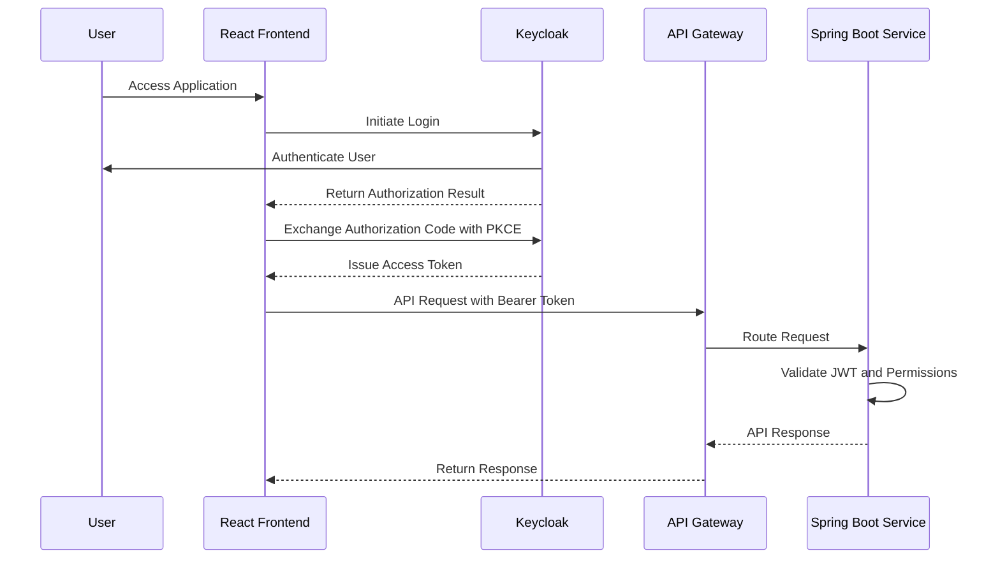
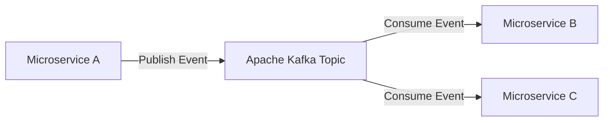

# 🏋️ FitVerse – AI-Powered Fitness Platform

**FitVerse** is a full-stack, AI-powered fitness application built using a **microservices architecture** to provide a modern, scalable, and personalized fitness experience.

The application combines **React.js**, **Spring Boot**, **PostgreSQL**, **MongoDB**, **Apache Kafka**, **Keycloak**, and **Google Gemini AI** to deliver intelligent fitness-related services with secure authentication, distributed data management, and asynchronous communication.

FitVerse is designed to demonstrate real-world backend engineering concepts, including microservices, service discovery, API gateway routing, event-driven architecture, OAuth2 authentication, and integration with generative AI.

> 🚧 **Project Status:** Under Active Development

---

## 🌟 Key Highlights

- 🏗️ Microservices-based backend architecture
- ⚛️ Modern frontend using React.js
- ☕ RESTful APIs powered by Java and Spring Boot
- 🗄️ Hybrid database architecture using PostgreSQL and MongoDB
- 🤖 Google Gemini AI integration
- 🔐 OAuth2 and OpenID Connect authentication using Keycloak
- 📨 Event-driven asynchronous communication using Apache Kafka
- 🔎 Service discovery using Netflix Eureka Server
- 🌐 Centralized API routing through an API Gateway
- 🛡️ Spring Security for API protection
- ✅ Request validation using Spring Boot Validation
- 📦 Modular architecture for maintainability and scalability

---

## 🚀 Project Overview

FitVerse aims to build an intelligent fitness ecosystem by combining modern web development technologies with distributed backend services.

Unlike traditional monolithic applications, FitVerse follows a **microservices architecture**, where individual services can be developed, deployed, and maintained independently.

The platform focuses on three major engineering principles:

1. **Scalability:** Independently scalable backend services.
2. **Security:** Centralized identity and access management using Keycloak.
3. **Intelligence:** AI-powered capabilities using Google Gemini.

The application uses both relational and document-oriented databases to support different data storage requirements.

---

## 🛠️ Technology Stack

### 🎨 Frontend

| Technology | Purpose |
|---|---|
| React.js | Component-based frontend development |
| JavaScript | Frontend application logic |
| HTML5 | Application structure |
| CSS3 | Styling and responsive layouts |
| REST APIs | Communication with backend services |

### ⚙️ Backend

| Technology | Purpose |
|---|---|
| Java | Backend programming language |
| Spring Boot | Microservices development |
| Spring Web | RESTful API development |
| Spring Data JPA | Relational database persistence |
| Spring Data MongoDB | NoSQL database operations |
| Spring Security | Authentication and authorization enforcement |
| Spring Validation | Request and data validation |
| Spring Cloud Netflix Eureka | Service registration and discovery |
| Spring Cloud Gateway | API routing, if configured as the gateway |

### 🗄️ Database

| Database | Purpose |
|---|---|
| PostgreSQL | Relational and structured data |
| MongoDB | Flexible document-based data |

FitVerse follows a **polyglot persistence approach**, using different database technologies based on the requirements of individual services.

**PostgreSQL** is suitable for structured relational data requiring strong consistency and transactional operations.

**MongoDB** supports flexible document models for data that may evolve over time.

### 🔐 Authentication & Security

| Technology | Purpose |
|---|---|
| Keycloak | Identity and access management |
| OAuth 2.0 | Authorization framework |
| OpenID Connect | User authentication |
| Spring Security | Securing backend APIs |
| JWT | Token-based API authentication |

### 📨 Microservices Communication

| Technology | Purpose |
|---|---|
| REST APIs | Synchronous communication |
| Apache Kafka | Asynchronous event-driven communication |
| Netflix Eureka | Service discovery |
| API Gateway | Centralized routing and entry point |

### 🤖 Artificial Intelligence

| Technology | Purpose |
|---|---|
| Google Gemini AI | Generative AI integration |
| Gemini API | AI-powered request processing |

---

## 🏗️ System Architecture

FitVerse uses a distributed architecture where the frontend communicates with backend services through an API Gateway.

The Eureka Server manages service discovery, while Kafka enables asynchronous communication between services.



### Architecture Components

**1. React Frontend**

Provides the user interface and communicates with backend APIs.

**2. API Gateway**

Acts as the centralized entry point for incoming client requests.

Responsibilities may include:

- Request routing
- Authentication integration
- Cross-origin resource sharing configuration
- Centralized request handling

**3. Eureka Discovery Server**

Maintains a registry of available microservices, allowing services to discover one another dynamically.

**4. Spring Boot Microservices**

Contains independently managed backend services responsible for application functionality.

**5. PostgreSQL and MongoDB**

Provide relational and document-oriented persistence according to service requirements.

**6. Apache Kafka**

Enables asynchronous, event-driven communication between microservices.

**7. Keycloak**

Provides centralized identity management using OAuth2 and OpenID Connect.

**8. Google Gemini AI**

Provides generative AI capabilities for intelligent fitness-related features.

---

## 🔐 Authentication & Authorization

FitVerse integrates **Keycloak** as its OAuth2 and OpenID Connect identity provider.

Spring Security protects backend resources and validates authentication tokens.

### Authentication Flow



### Security Features

- Centralized user authentication
- OAuth2 authorization
- OpenID Connect integration
- JWT-based API security
- Protected REST endpoints
- Role-based access control
- Spring Security resource server integration

---

## 📨 Event-Driven Architecture with Apache Kafka

FitVerse uses **Apache Kafka** to support asynchronous communication between microservices.

Kafka enables services to publish and consume events without requiring direct synchronous communication for every operation.

### Kafka Communication Flow



### Benefits

- Loose coupling between microservices
- Asynchronous event processing
- Independent event producers and consumers
- Improved resilience to temporary service unavailability
- Scalable message processing
- Support for event-driven workflows

---

## 🤖 Google Gemini AI Integration

FitVerse integrates **Google Gemini AI** to support intelligent fitness-related functionality.

Potential AI-powered capabilities include:

- Personalized workout recommendations
- AI-generated fitness guidance
- Customized training suggestions
- Fitness-related question answering
- Personalized wellness recommendations

The Gemini API is accessed through backend services, allowing AI functionality to remain separated from frontend implementation.

> AI capabilities are being developed as part of the FitVerse roadmap. Specific features will be documented as they are implemented.

---

## 🗄️ Database Architecture

FitVerse uses two database technologies to address different persistence requirements.

### PostgreSQL

PostgreSQL provides relational data storage with support for:

- Structured entities
- Relationships between entities
- Transaction management
- Data integrity
- SQL-based querying

Spring Data JPA provides object-relational mapping and database access.

### MongoDB

MongoDB provides document-oriented storage with support for:

- Flexible document structures
- JSON-like data representation
- Evolving data models
- Document-based queries

Spring Data MongoDB simplifies repository operations and document persistence.

### Persistence Strategy

Each microservice can use the database technology that best suits its requirements.

The architecture aims to avoid unnecessary coupling between service-specific data models.

---

## 🔎 Service Discovery with Eureka

FitVerse uses **Netflix Eureka Server** for microservice registration and discovery.

### How It Works

1. Eureka Server starts and maintains a service registry.
2. Spring Boot microservices register themselves with Eureka.
3. Registered services periodically renew their leases.
4. Services and the API Gateway can discover registered service instances.
5. Service discovery supports dynamic routing and inter-service communication.

### Benefits

- Dynamic service discovery
- Reduced dependency on hardcoded service addresses
- Support for multiple service instances
- Improved flexibility in distributed deployments

> **Note:** Eureka is a service discovery server, not an API Gateway. Spring Cloud Gateway can be used separately for centralized request routing.

---

## 📁 Project Structure

The following is a suggested organization for the microservices-based repository. Actual directories may vary as development progresses.

```text
FitVerse/
│
├── frontend/
│   └── React Application
│
├── backend/
│   │
│   ├── api-gateway/
│   │
│   ├── eureka-server/
│   │
│   └── microservices/
│       └── Spring Boot Services
│
├── README.md
│
└── .gitignore
```

Additional service modules, infrastructure configurations, and documentation can be added as the application evolves.

---

## ⚙️ Installation & Setup

### Prerequisites

Before running FitVerse, ensure that the following tools and services are available:

- Java JDK compatible with the selected Spring Boot version
- Node.js and npm
- Maven
- PostgreSQL
- MongoDB
- Apache Kafka
- Keycloak
- Google Gemini API key
- Git

### 1. Clone the Repository

```bash
git clone https://github.com/Rashmi-2005-Ranjan/FitVerse.git
cd FitVerse
```

### 2. Configure Backend Services

Configure each Spring Boot microservice with the appropriate environment settings.

A typical PostgreSQL configuration:

```properties
spring.datasource.url=${POSTGRES_URL}
spring.datasource.username=${POSTGRES_USERNAME}
spring.datasource.password=${POSTGRES_PASSWORD}
```

A typical MongoDB configuration:

```properties
spring.data.mongodb.uri=${MONGODB_URI}
```

A typical Eureka client configuration:

```properties
eureka.client.service-url.defaultZone=${EUREKA_SERVER_URL}
```

A typical Kafka configuration:

```properties
spring.kafka.bootstrap-servers=${KAFKA_BOOTSTRAP_SERVERS}
```

A typical Spring Security OAuth2 resource server configuration:

```properties
spring.security.oauth2.resourceserver.jwt.issuer-uri=${KEYCLOAK_ISSUER_URI}
```

Google Gemini API credentials should be configured using environment variables or an appropriate secrets-management solution.

```properties
GEMINI_API_KEY=${GEMINI_API_KEY}
```

> Configuration property names and environment variable bindings should be adjusted to match the actual implementation of each service.

### 3. Start Infrastructure Services

Ensure the required infrastructure is running:

1. PostgreSQL
2. MongoDB
3. Apache Kafka
4. Keycloak

### 4. Start Eureka Server

Navigate to the Eureka Server module and start the application.

```bash
mvn spring-boot:run
```

### 5. Start Spring Boot Microservices

Run each backend service independently using Maven.

```bash
mvn spring-boot:run
```

### 6. Start the API Gateway

Start the configured gateway service after the required infrastructure and discovery services are available.

### 7. Start React Frontend

Navigate to the frontend directory.

```bash
cd frontend
npm install
npm run dev
```

Open the local development URL displayed by the frontend development server.

---

## 🔄 Development Workflow

FitVerse follows a modular development approach.

### Frontend Development

- Develop reusable React components
- Integrate REST APIs
- Handle authentication flows
- Build responsive user interfaces

### Backend Development

- Design RESTful APIs
- Implement Spring Boot services
- Configure persistence layers
- Secure endpoints using Spring Security
- Integrate Kafka producers and consumers
- Connect AI functionality through Gemini APIs

### Microservices Integration

- Register services with Eureka
- Configure API Gateway routing
- Integrate Keycloak authentication
- Establish asynchronous Kafka communication
- Manage database connectivity independently

---

## 📈 Future Roadmap

The following capabilities are planned or being explored:

- [ ] Complete microservices integration
- [ ] Personalized fitness dashboard
- [ ] Workout planning and tracking
- [ ] AI-powered workout recommendations
- [ ] Fitness progress analytics
- [ ] Nutrition and wellness recommendations
- [ ] Event-driven notification workflows
- [ ] Containerization using Docker
- [ ] Automated CI/CD pipeline
- [ ] Distributed monitoring and observability
- [ ] Production deployment

---

## 🎯 Project Objectives

FitVerse is being developed to strengthen practical experience in:

- Full-stack application development
- Java and Spring Boot backend engineering
- Microservices architecture
- Distributed systems
- Event-driven communication
- OAuth2 and OpenID Connect security
- Relational and NoSQL database integration
- Generative AI integration
- Scalable application design

---

## 👨‍💻 Developer

**Rashmi Ranjan Behera**

Full-Stack Developer | Java | Spring Boot | React.js | Microservices

**GitHub:** [Rashmi-2005-Ranjan](https://github.com/Rashmi-2005-Ranjan)

---

## ⭐ Support

If you find FitVerse interesting, consider giving the repository a ⭐ on GitHub.

Contributions, feedback, and suggestions are welcome as the project evolves.

---

**Built with Java, Spring Boot, React, Microservices, and AI.**

### Happy Coding! 🚀
